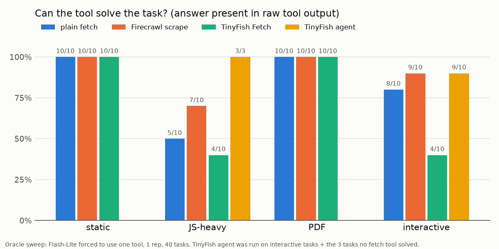
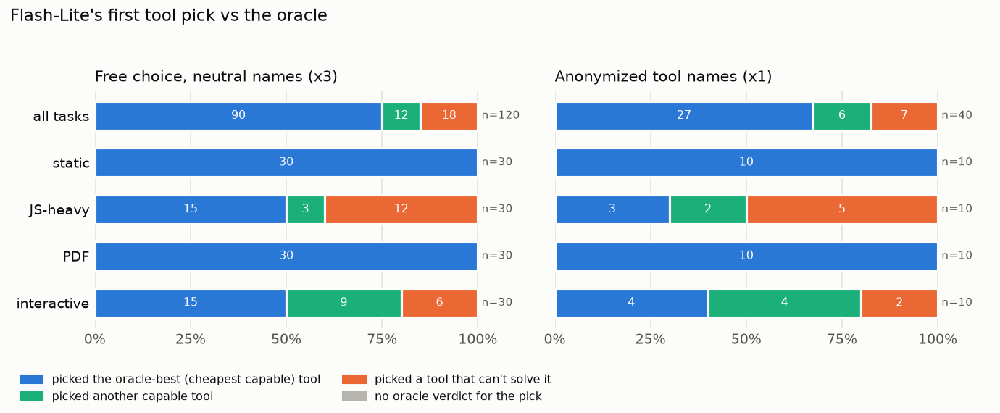

# tool-selection-bench

**When an LLM agent has several web tools, which one does it pick for a task, and was that the right pick?**

This is a small, cheap benchmark. It gives one tool-calling agent four web tools:
- a plain HTTP fetch, the baseline
- Firecrawl scrape
- TinyFish Fetch
- the TinyFish browser agent

It runs 40 tasks with checkable answers and scores two things. First, whether each tool *could* solve each task (the oracle). Second, which tool the model *actually* picks when it can choose freely. Everything ran on free tiers, with $0 spent.

## Method

**Tasks.** There are 40 tasks: 10 static pages, 10 JavaScript-heavy pages, 10 PDFs, and 10 interactive tasks (pagination, search, AJAX tables). Every task has one short, verifiable answer, in `tasks/tasks.jsonl`. They use public practice sites (toscrape.com, scrapethissite.com, scrapingcourse.com, DataTables examples), arXiv papers, docs and RFCs. No site needs a login, and none bans scraping in its terms.

**Agent.** There is one LiteLLM loop. The system prompt is neutral ("Answer the question using the tools available."), with at most 3 tool calls, then a forced final answer. Tool output reaches the model truncated to 50k characters. The main model is **Gemini 3.5 Flash-Lite**, at temperature 0.

**Tools** (descriptions shown to the model are factual and of similar length, in `config.toml`):

| tool | what it is |
|---|---|
| `plain_fetch` | httpx GET + readability + markdownify, with a pypdf fallback. No JavaScript. |
| `firecrawl_scrape` | Firecrawl v2 `/scrape`, markdown output. Runs JavaScript and parses PDFs. |
| `tinyfish_fetch` | TinyFish Fetch API, markdown output. Runs JavaScript. |
| `tinyfish_agent` | TinyFish browser agent with a start URL and a plain-language goal, capped at 5 steps. |

**Oracle: "can this tool solve this task?"** The model is given exactly one tool and must call it on its first turn. One rep for each task × tool pair.
- The oracle verdict is whether **the answer is present in the raw tool output**. It is checked offline against the saved, untruncated outputs.
- Flash-Lite's own extraction is reported as a separate column, so a model reading error never counts against the tool.
- Counting tasks were hand-labeled from the raw outputs, listed in `tasks/oracle_hand_labels.json`.
- "Name at position N" tasks also require the right page URL, and the name has to sit at the right position.
- The TinyFish agent was run on the interactive tasks and on the 3 tasks no fetch tool could solve.

**Free choice.** All four tools are offered with neutral descriptions in a fixed order, and the model picks. 40 tasks × 3 reps.
- The **first pick** is compared against the oracle.
- **Oracle-best** is the cheapest tool that can solve the task, ordered plain fetch < TinyFish Fetch < Firecrawl < TinyFish agent.

**Ablation.** Anonymized tool names: the tools are called `tool_1`…`tool_4`, and brand names are removed from the descriptions. 40 tasks × 1 rep.

**Scoring.**
- Answers are scored with deterministic checks that tolerate format differences. For example, 2.3×10^19, 2.3e19 and 23,000,000,000,000,000,000 all pass, and decoy tests confirm a wrong value fails.
- Answers to 5 list or free-text tasks go to an LLM judge (Gemini 3.8 Flash) with a fixed rubric.
- Every result is **correct**, **wrong**, **abstained** (empty answer, reported apart from wrong), or **pending** (judge quota).

## Findings



**1. Static pages and PDFs are solved; JavaScript and interaction separate the tools.**
- Every fetch tool solves 10/10 static and 10/10 PDF tasks.
- On JS-heavy tasks: Firecrawl 7/10, plain fetch 5/10 (via non-JS routes such as JSON endpoints or the site's non-JS pages), TinyFish Fetch 4/10.
- On interactive tasks: Firecrawl 9/10, the TinyFish agent 9/10, plain fetch 8/10, TinyFish Fetch 4/10.
- Totals: Firecrawl 36/40, plain 33/40, TinyFish Fetch 28/40, and the TinyFish agent 12/13 on the tasks it was run on.
- Three tasks (delayed JS rendering, infinite scroll, a server-side DataTable) were solved only by the browser agent.

**2. The raw outputs show content loss inside the tools, not blocks.**
- No call hit a Cloudflare or bot challenge.
- Plain fetch's readability step drops whole quote blocks on list pages (e.g. 7 of 10 on one page). That loss decides two tasks.
- TinyFish Fetch sometimes returned partial renders: 3 of 10 quotes, listing pages with prices but no titles, and collapsed API docs.
- In 9 TinyFish Fetch cells, the model then gave an empty answer.



**3. The model almost always picks the cheapest tool, and on the easy categories that's right.**
- Flash-Lite's first pick was plain fetch in 105 of 120 rows, and the **same first tool in all 3 reps for 40/40 tasks**.
- The first pick could solve the task in **102/120 rows (85%)**: 100% on static and PDF, 80% on interactive, 60% on JS-heavy.
- It was the oracle-best (cheapest capable) tool in 90/120 rows.
- The misses concentrate where plain fetch can't run JavaScript. The model doesn't route around that from the task text alone, even though the description says "Does not run JavaScript".

**4. Most failures are selection failures.**
- 95 of 106 decided rows were correct (14 rows still wait on the judge).
- Of the 11 rows not correct despite a capable tool existing, 7 followed a first pick that couldn't solve the task.
- The other 4 followed a good first pick: three hedged answers on one PDF table, and one abstention.

**5. The browser agent was expensive and rarely chosen.** In free choice it handled 25 of 189 tool calls, using 121 steps (about $1.94 at list price, paid from TinyFish signup credit). It was the first pick in only 3 of 120 rows.

**6. Brand names barely matter.** With the tools renamed `tool_1`…`tool_4` and brands stripped from the descriptions (40 tasks × 1 rep):
- The first pick could solve the task in **33/40 (82%)**, vs 85% with names. It was oracle-best in 27/40 (68%), vs 75%.
- Plain fetch is still the first pick in 31/40 rows.
- The shift is on JS-heavy tasks: without names, the model moved some first picks from plain fetch to `tool_3` (TinyFish Fetch, 4 of 10). That's the weakest JS tool in the oracle, so JS selection got slightly worse (5/10, vs 18/30).
- The browser agent was the first pick for 3 of 10 interactive tasks, vs 3 of 30 rows with names.
- With one rep this is a direction, not a significant effect.
- Outcomes: 31 correct, 2 wrong, 2 abstained, 5 pending judge.

## Limitations

- **Gemini family only.** One main model (Gemini 3.5 Flash-Lite) and one judge (Gemini 3.8 Flash). A second-vendor model was planned, but the free options fell through: Groq's Scout was shut down, Mistral's free plan was withdrawn, and NVIDIA's free endpoints returned 404s and timeouts. Details are in NOTES.md. Picks by other model families may differ.
- **Tools mostly on documented defaults, with these deviations, all recorded in NOTES.md:**
  - Firecrawl's PDF parser is capped at 10 pages, the same cap as plain fetch, chosen to save credits, and its image parser is off.
  - TinyFish Fetch's per-URL timeout is 60 s rather than unset.
  - Measured impact on the oracle is none: every PDF answer sits in the first 10 pages, no task is an image, and no Fetch call timed out.
  - Documented Fetch options we did not use: CSS `include_selectors` (per-site tuning) and `ttl: 0` (a forced live fetch). A cached partial render is therefore not ruled out.
- **Small and partly memorized.**
  - There are 40 tasks and one oracle rep. Flash-Lite answers 7 tasks correctly with no tools (one is a deliberate known-answer control), including a fully memorized DataTables sample dataset; those are flagged `memorized` in the task file.
  - Static and PDF tasks are easy for every tool, so the JS-heavy and interactive categories carry most of the signal: 8 clean JS tasks after memorization.
- **The judge is unvalidated.** The planned check against 20 hand labels was not done. Judge-task verdicts still pending on the free-tier quota are shown as "pending", not guessed.
- **Free-tier quotas shape the runs.** Flash-Lite's free daily limit turned out to be about 500 requests, half our initial placeholder of 1,000, so runs paused and resumed across days. Resumes are deterministic: completed rows are kept.
- **One ablation.** Shuffled tool order and salesy descriptions were planned but not run.

## Reproduce

```
uv sync
cp .env.example .env            # GEMINI_API_KEY, FIRECRAWL_API_KEY, TINYFISH_API_KEY
uv run pytest -q
uv run python -m bench oracle               # task x tool oracle sweep
uv run python -m bench oracle --agent-gaps  # browser agent on tasks no fetch tool solved
uv run python -m bench run --model flash-lite --mode free --reps 3
uv run python -m bench run --model flash-lite --mode anon --reps 1
uv run python -m bench oracle-table         # runs/oracle_table.md
uv run python -m bench free-summary         # runs/<run>/summary.md
uv run python -m bench report               # charts/
```

If a run stops on a free quota (exit code 3), rerun the same command later to resume. Run logs are committed under `runs/`. The full raw tool outputs (`runs/*/raw/`) are kept local and not committed. Design decisions and the full history are in `NOTES.md`.
